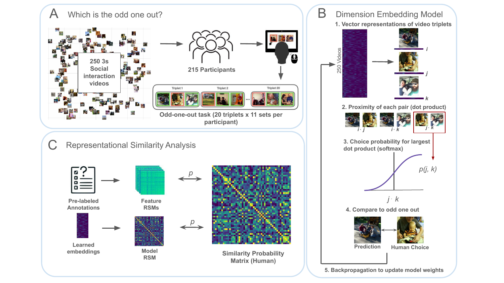
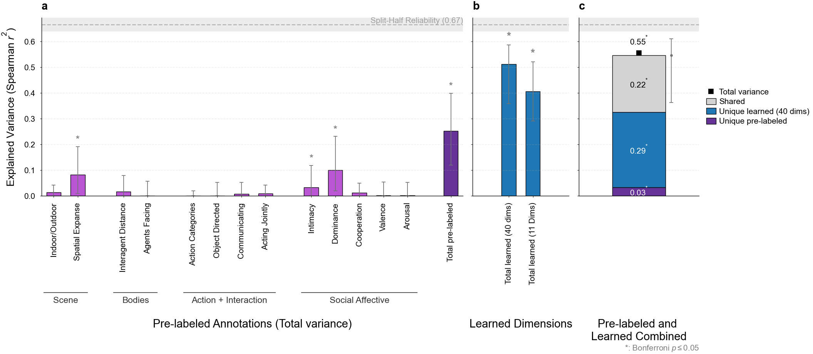
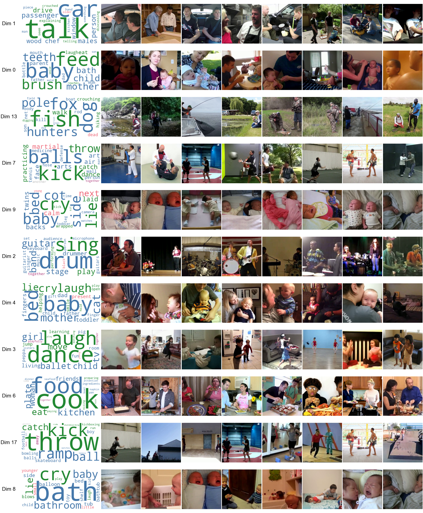
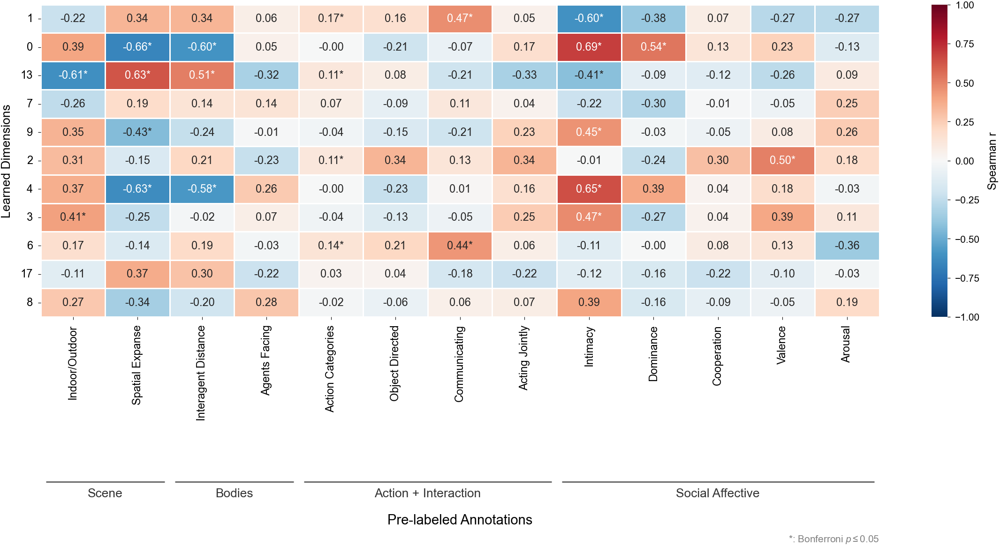
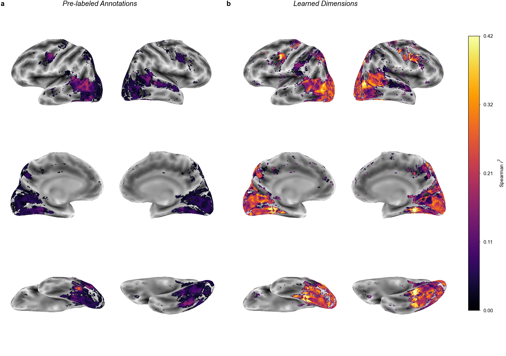

# Human similarity judgments reveal fine-grained representations of relationships and actions in dynamic social scenes

Code and data for the preprint *Human similarity judgments reveal fine-grained representations of relationships and actions in dynamic social scenes*
([doi:10.31234/osf.io/8cn9f_v1](https://doi.org/10.31234/osf.io/8cn9f_v1)).

We learn a sparse, non-negative embedding of 250 naturalistic social-interaction
videos from human odd-one-out triplet judgments (following Hebart et al., 2020),
select its most informative dimensions, interpret them from video captions, and
compare them with 12 pre-labeled annotations (plus action category) as predictors
of human similarity and of fMRI responses.



**Fig. 1.** (a) Participants chose the odd one out in triplets of 3-s social
interaction videos. (b) A dimension embedding model is trained to predict those
choices. (c) The learned embedding and the pre-labeled annotations are compared
with human similarity through representational similarity analysis (RSA).

The sections below follow the analysis in order. Every step writes its results to
`data/interim/`, and the results each figure needs are committed, so any figure can
be rebuilt without re-running the steps before it.

## Setup

Python 3.11. Run every command from the repository root.

```bash
python -m venv .venv
source .venv/bin/activate
pip install -r requirements.txt
```

## 1. Data

All stimulus and behavioral data are in `data/utils/`.

- **Stimuli.** 250 videos, split into 200 train and 50 test videos (`train.csv`,
  `test.csv`). Each has an action category (`train_categories.csv`,
  `test_categories.csv`), captions (`frame_data.csv`) and 12 pre-labeled annotations
  (`annotations.csv`). One frame per video is in `data/raw/images/`;
  these are third-party images from the Moments in Time dataset.
- **Training triplets.** `train_triplets.npy`, 44,535 odd-one-out judgments over all
  250 videos, with columns `i, j, k, chosen_pair_idx`. The last column names the
  *similar* pair: 0 → (i, j), 1 → (i, k), 2 → (j, k). `val_triplets.npy` (4,949) is
  the validation split used for early stopping during training.
- **Test triplets.** `test_triplets.csv`, 3,739 new judgments on the 50 test
  videos only, collected separately and never used for training. Here `choice` is
  the *odd-one-out's* stimulus id, the opposite convention to the training file;
  `helpers/reliability.py` loads both into the same format.
- **Human similarity matrices (RSMs).** `human_test_rsm.csv` is the dense 50 x 50
  test RSM (about 9 judgments per pair). All held-out evaluation uses it.
  `train_human_sim.npy` is the 250 x 250 train RSM (about 4 judgments per pair).
- **fMRI.** Four subjects from McMahon, Isik & Bonner (2025), available on OSF at
  [osf.io/4j29y](https://osf.io/4j29y) (see [Citation](#citation)). The
  test-video beta maps and the FreeSurfer surfaces are not in this repository.
  Download them into `data/raw/fmri/` with

  ```bash
  python analysis/neural/download_fmri.py                  # betas + surfaces (1.3 GB download)
  python analysis/neural/download_fmri.py --skip-surfaces  # betas only (~140 MB)
  ```

  The surfaces are needed only to draw brain maps. The voxel reliability masks
  (`data/raw/fmri/reliability_mask/`) are not on OSF and are included here.
  Per-subject ROI RSMs for nine regions are in `data/interim/rsms/`. They were built
  by `analysis/neural/neural_rsa.py` from voxel responses and voxel metadata
  that are not included here (the script looks for them in
  `data/raw/fmri/voxel_responses/`).

**Noise ceilings.** Split-half reliability of the human RSMs, Spearman–Brown
corrected and computed at the triplet level (`helpers/reliability.py`), is
Spearman r² 0.486 for the train RSM and 0.666 for the test RSM.

## 2. Embedding model

A sparse, non-negative triplet embedding (Hebart et al., 2020;
`helpers/data_helpers.py`, `VideoEmbeddingModel`). Each video gets a 90-dimensional
non-negative vector. The similarity of a pair is the dot product of their vectors,
and a softmax over the three pairs in a triplet predicts which video is the odd one
out. An L1 penalty (λ = 0.011) keeps the vectors sparse. Training uses the train
triplets only, with early stopping on the validation split (seed 888, up to 1,000
epochs, patience 50). Dimensions whose largest value is below 0.1 are then pruned,
leaving **40 dimensions**.

```bash
python training/train_embedding_model.py --out-dir data/interim/model_refit
```

The published embedding is `data/interim/model/sparse_pruned_emb_sorted.npy`
(250 videos x 40 dimensions), and every later step reads it. The script refuses to
overwrite it unless you pass `--overwrite`. A retrain is not guaranteed to reproduce
it exactly across hardware and library versions.

## 3. Dimension selection

Greedy forward selection adds, one at a time, the dimension that most improves a
cross-validated regression of the **train** RSM on the dimensions' RSMs (10-fold x
5 repeats). A Kneedle elbow on the cumulative curve picks **11 dimensions**:
`BEST_DIMS = [1, 0, 13, 7, 9, 2, 4, 3, 6, 17, 8]` in `config.py`. The test RSM is
not used for selection.

```bash
python analysis/behavioral/dim_selection_train.py
```

This writes the greedy order to
`data/interim/results/behavioral/greedy_forward_r2_train.csv`, which later figures
use to order dimensions.

**Stability.** To test whether the dimensions recur, the model is refit 20 times,
over different seeds and bootstrap samples of the triplets, and each dimension is
matched to its closest counterpart in each refit:

```bash
python analysis/stability/dimension_recoverability.py
python analysis/stability/dimension_recoverability_hebart.py
python analysis/stability/fractionation_across_seeds.py
```

## 4. Learned dimensions explain human similarity better than annotations (Fig. 2)



Each annotation and each learned dimension becomes a model RSM. Cross-validated
regression of the test RSM on those model RSMs gives the variance each set explains,
scored as Spearman r² of the out-of-fold predictions (`helpers/variance_partition.py`).
Panel c splits the variance of the combined model into parts unique to each set and
a shared part. Significance comes from permuting video labels (rows and columns of
the RSM together, 1,000 permutations), Bonferroni-corrected. Error bars are 95%
bootstrap CIs over test videos.

```bash
python analysis/behavioral/explained_variance_shared_only.py --perm video --ci   # permutation + bootstrap caches
python analysis/make_paper_figures.py fig2
```

## 5. Interpreting the dimensions from captions (Fig. 3)



For each of the 11 selected dimensions, Fig. 3 shows the 8 videos that load most
strongly on it and a word cloud of the caption words that best separate those
videos from the 8 lowest-loading ones. Words are ranked by a frequency-weighted log
ratio, averaged over 200 random tie-breaks: many videos score exactly 0 on a sparse
dimension, so the bottom 8 is otherwise arbitrary.

```bash
python analysis/dimensions/dimension_interpretation.py   # caption statistics, all 40 dims
python analysis/make_paper_figures.py fig3
```

## 6. How the dimensions relate to the annotations (Fig. 4)



Spearman correlation between each of the 11 selected dimensions and each annotation,
across the 50 test videos. The Action Categories column instead correlates each
dimension's RSM with a same-category RSM, tested by permuting video labels (5,000
permutations). Stars mark Bonferroni-corrected p ≤ .05 within each row.

```bash
python analysis/make_paper_figures.py heatmaps
```

## 7. The learned dimensions predict brain responses (Fig. 5)



Whole-brain searchlight RSA for one subject (sub-02). In each sphere (radius 3 voxels,
within the subject's reliability mask), the neural RSM of the 50 test videos is
predicted from (a) the 12 annotations plus action category or (b) the 40 learned
dimensions, and scored as cross-validated Spearman r². CV is 10-fold over stimulus
pairs, so a held-out pair's videos also appear in training pairs.

```bash
python analysis/neural/download_fmri.py   # once: betas + surfaces from OSF
python analysis/neural/searchlight_rsa.py --dims all --n-folds 10 --n-jobs 10 --no-plot
python analysis/neural/searchlight_behavioral_rsa.py --include-action --n-folds 10 --n-jobs 10 --no-plot
python analysis/make_paper_figures.py fig5
```

The searchlight maps take a few minutes per subject. Rendering the brain surfaces
takes 10–20 min.

## Extended Data

`python analysis/make_paper_figures.py` with no arguments builds every figure,
including Extended Data, into `paper_figures/`.

| Figure | Key | Content | Needs first |
|---|---|---|---|
| ED Fig. 1 | `ed1` | Cumulative r² along the greedy order | step 3 |
| ED Fig. 2 | `ed2` | Dimension recoverability across refits | step 3 (stability) |
| ED Fig. 3 | `fig3` | Caption grid, remaining 29 dimensions | step 5 |
| ED Fig. 4 | `heatmaps` | Inter-dimension correlations | – |
| ED Fig. 5 | `heatmaps` | Dimension x annotation correlations, all 40 dimensions | – |
| ED Fig. 6 | `ed6` | Searchlight r², both models, all subjects | step 7 |
| ED Fig. 7 | `ed7` | Searchlight r², annotations vs 11 dimensions | `searchlight_rsa.py --greedy-k 11 --n-folds 10 --subjects 2 --combined-only --no-plot` |
| ED Fig. 8 | `ed8` | ROI model fit, per-subject mean | – |
| ED Fig. 9 | `ed9` | Whole-brain winner-take-all over the 11 dimensions | `searchlight_rsa.py --readout marginal --n-jobs 6` |
| ED Table 1 | – | Top-10 caption words, all 40 dimensions | step 5; written to `data/interim/results/dimensions/table_contrastive_top10_all_publication.tex` |

## Repository layout

```
config.py                  paths, hyperparameters, seeds, BEST_DIMS, train/test indices
training/                  embedding model training
analysis/
  make_paper_figures.py      builds every paper figure into paper_figures/
  behavioral/                dimension selection, variance partition, noise ceilings
  dimensions/                caption analysis, dimension x annotation correlations
  stability/                 recoverability of the dimensions across refits
  neural/                    ROI RSA and whole-brain searchlight RSA
helpers/                   shared code: model, RSA regression, reliability,
                           bootstrap, surfaces, action categories, figure style
data/
  utils/                     stimuli, annotations, triplets, human RSMs
  raw/                       video frames, fMRI reliability masks
                             (betas and surfaces: download from OSF)
  interim/                   embedding, ROI RSMs, cached results
paper_figures/             final figures (PDF + PNG)
```

## Citation

If you use this code or data, please cite the preprint:

> Garcia, K., & Isik, L. (2026). *Human similarity judgments reveal fine-grained representations of relationships and actions in dynamic social scenes*. PsyArXiv. https://doi.org/10.31234/osf.io/8cn9f_v1

If you use the fMRI data, please also cite the dataset it comes from:

> McMahon, E., Isik, L., & Bonner, M. F. (2025, May 27). *Hierarchical organization of social action features along the lateral visual pathway*. Retrieved from https://osf.io/4j29y

## License

Code is released under the [MIT License](LICENSE).
